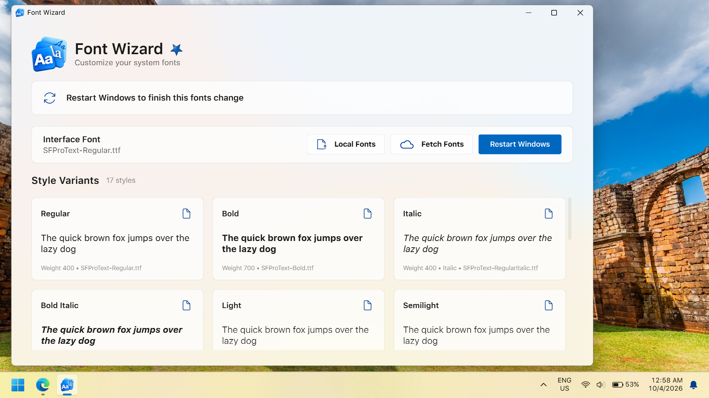

>Note: v6 has been released with all previous issues <b> fixed </b>

<p align="center">
  
</p>

<h1 align="center"> Font Wizard 6</h1>

<p align="center">
  <b>Change Windows 11 &amp; 10 system font Everywhere</b>.<br>
  Start, Taskbar, Lockscreen, Old Legacy Apps, New UWP &amp; WinUI apps, everywhere.<br>
  
</p>

---

<h1 align="center">📸 Screenshots</h1>

<p align="center">
  
</p>

<p align="center">
  
</p>

<p align="center">
  
</p>

<p align="center">
  
</p>

---

### If you wish to install via terminal

```powershell
winget install -e --id karnyadavdev.FontWizard
```

## Interface language

Font Wizard uses Simplified Chinese (简体中文) or Traditional Chinese (繁體中文) when Chinese is your first preferred app language in Windows. For other languages, it uses English. To choose a language explicitly, set `FONTWIZARD_LANGUAGE` to `en`, `zh-Hans`, or `zh-Hant` before launching the app.

## Build from Source

```bat
.\App\build.bat
```

Build output goes to `App\dist\`.
