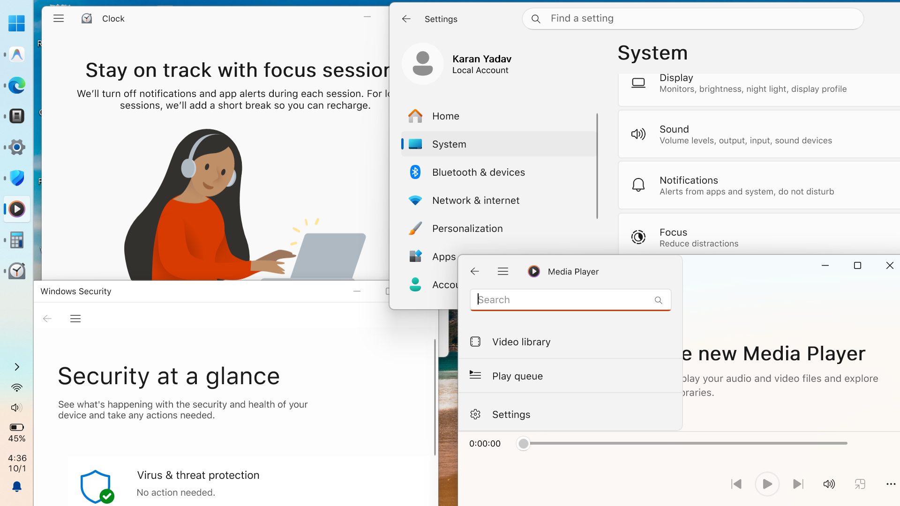
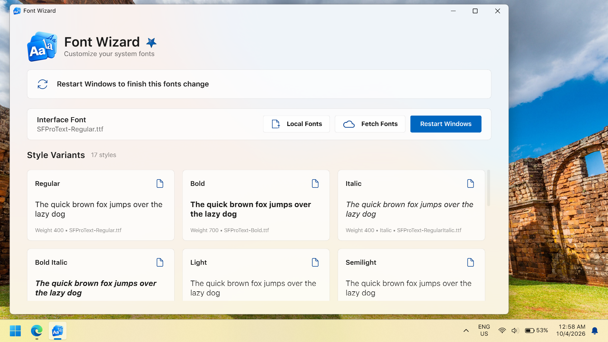
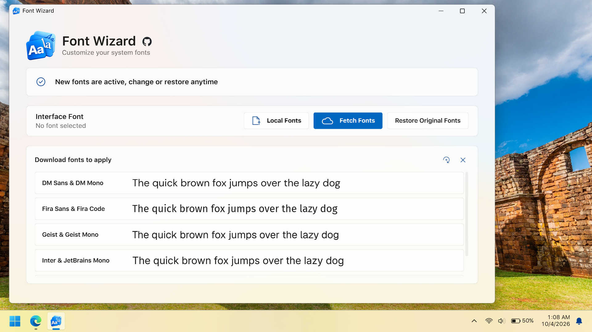

<p align="center">
  
</p>

<h1 align="center"> Font Wizard 5</h1>

<p align="center">
  <b>Change Windows 11 & 10 system font Everywhere</b>. <br>  Start, Taskbar, Lockscreen, Old Apps, New UWP & WinUI apps, everywhere <br><br> ⭐ New Version will release on reaching 200 stars 
  

  

---


 <h1 align="center">📸 Screenshots</h1>
</p>

<p align="center">
  
</p>

<p align="center">
  
</p>
<p align="center">
  
</p>


<p align="center">
  
</p>


---
<table>
<tr>
<td width="50%" align="center" valign="top">

## 📥 Download

> Download latest release [**here**](https://github.com/karnyadavdev/fontwizard/releases/latest)

</td>
<td width="50%" align="center" valign="top">

### Install from Microsoft servers via Terminal

```powershell
winget install -e --id karnyadavdev.FontWizard
```

</td>
</tr>
</table>


<a href="https://www.star-history.com/?repos=morluto%2Frea&amp;type=date">
  <picture>
    <source media="(prefers-color-scheme: dark)" srcset="https://api.star-history.com/chart?repos=karnyadavdev/FontWizard&amp;type=date&amp;theme=dark&amp;legend=top-left" />
    <source media="(prefers-color-scheme: light)" srcset="https://api.star-history.com/chart?repos=karnyadavdev/FontWizard&amp;type=date" />
    
  </picture>
</a>

## Build from Source


```bat
.\App\build.bat
```

Build output goes to `App\dist\`.
