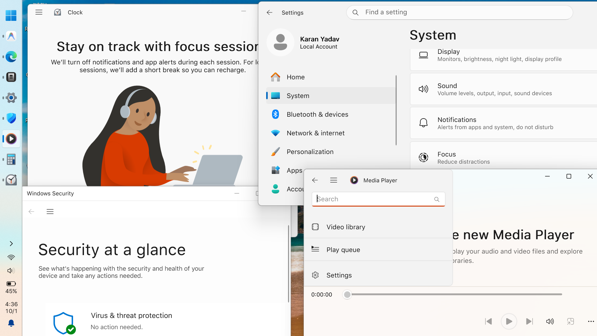
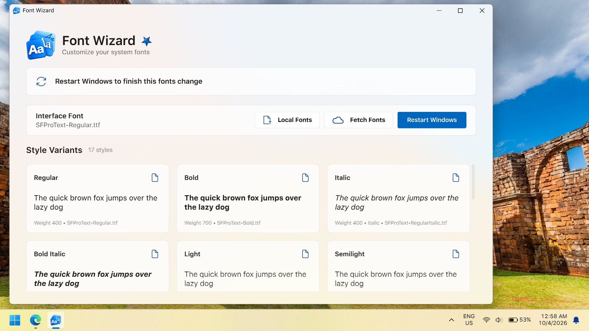
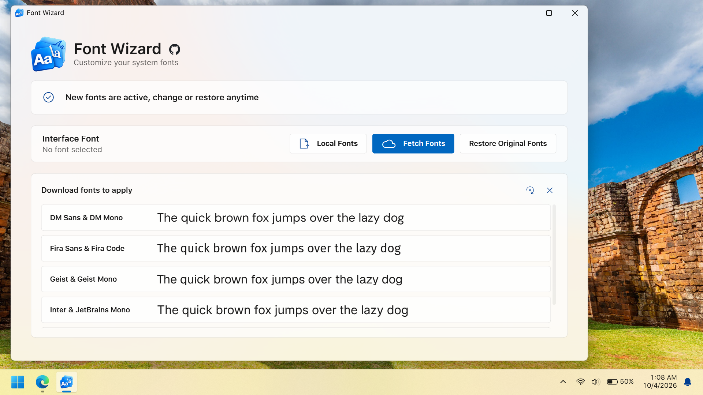

>Note: Version 6 is ready for release on November 9, adding support for Chinese, Korean, Japanese, and other languages. It also fixes an issue where English text in non-English apps continued to use Segoe UI, affecting users who have set their device language to English but use apps designed for other languages.
<p align="center">
  
</p>

<h1 align="center"> Font Wizard 5</h1>

<p align="center">
  <b>Change Windows 11 & 10 system font Everywhere</b>. <br>  Start, Taskbar, Lockscreen, Old Apps, New UWP & WinUI apps, everywhere <br>
  


  

---


 <h1 align="center">📸 Screenshots</h1>
</p>

<p align="center">
  
</p>

<p align="center">
  
</p>
<p align="center">
  
</p>


<p align="center">
  
</p>


---

### If you wish to install via terminal

```powershell
winget install -e --id karnyadavdev.FontWizard
```


## Build from Source


```bat
.\App\build.bat
```

Build output goes to `App\dist\`.
