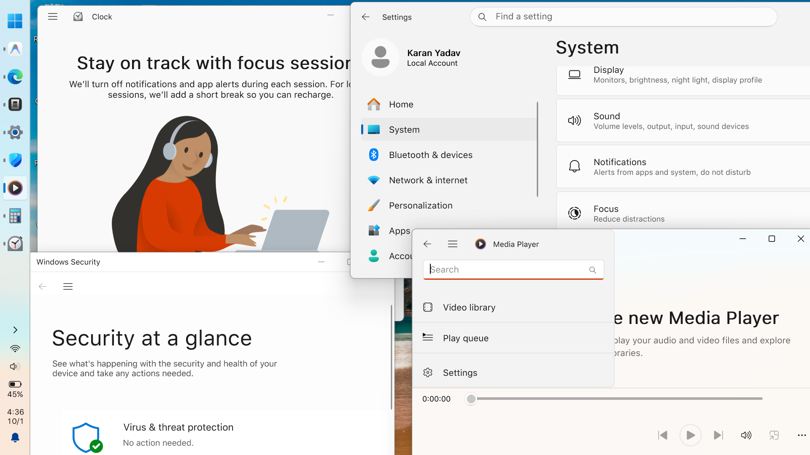
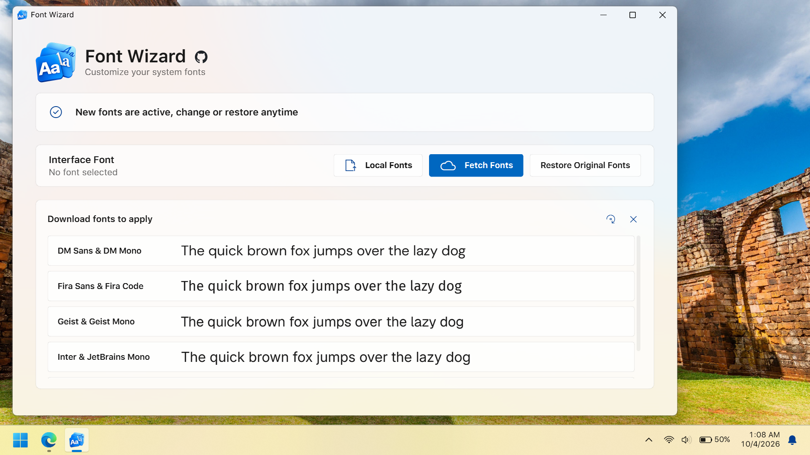

<p align="center">
  
</p>

<h1 align="center"> Font Wizard 6</h1>

<p align="center">
  <b>Change Windows 11 &amp; 10 system font Everywhere</b>.<br>
  Start, Taskbar, Lockscreen, All New & Old Windows Apps, Chrome, MS Office, Adobe Apps, everywhere.<br>
  <br><a href="https://github.com/karnyadavdev/FontWizard/releases/download/v6.0/Font_Wizard_6.exe">
        
      </a> <br> ⭐ Don't forget to put a star if you like the project! 
</p>

---

<h1 align="center">📸 Screenshots</h1>

<p align="center">
  
</p>

<p align="center">
  
</p>

<p align="center">
  
</p>

<p align="center">
  
</p>

---

### One-command install via Windows Terminal


```powershell
winget install -e --id karnyadavdev.FontWizard
```

## Build from Source

```bat
.\App\build.bat
```

Build output goes to `App\dist\`.
